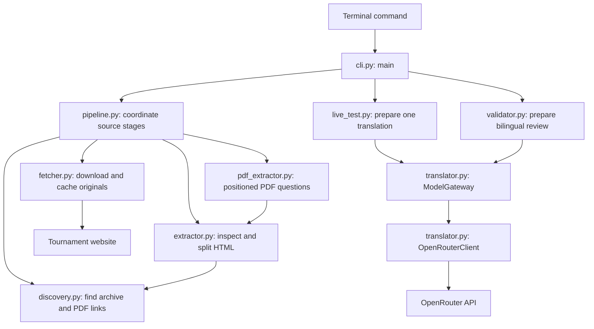
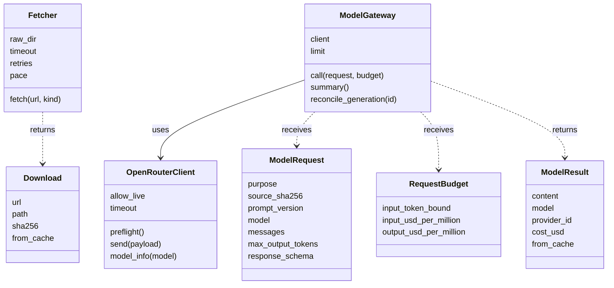

# Actual modules, classes, and reading order

Every .py file is a module. Not every module has a class. The present app has
separate CLI stages, not a completed automatic archive-to-final-PDF command.

| Module | Concrete responsibility | Main code |
| --- | --- | --- |
| cli.py | Read command arguments and select operation | main |
| pipeline.py | Coordinate downloading/inspection/extraction; save reports | run, inspect_sources, extract_cached_html, extract_cached_pdf |
| discovery.py | Read hrefs, resolve addresses, separate anchors | _Links, discover, discover_documents |
| fetcher.py | Source HTTP, cache, hash, timeout, retries, pacing | Fetcher.fetch |
| extractor.py | Source section/language/heading and fixed-column HTML questions | _Markers, section_html, check_language, inspect_html, inspect_pdf, extract_html_questions |
| pdf_extractor.py | Native spans, positions, scores, authors and script candidates | _read_lines, _script_evidence, _question, extract_pdf_page |
| models.py | Typed containers; not processing | SourceRef, Download, question/span/score classes, ModelRequest, RequestBudget, ModelResult |
| translator.py | Paid request policy, cost/cache/HTTPS | ModelGateway.call, OpenRouterClient, prepare_text_budget |
| live_test.py | Build the one-question real translation request | run_live_api_test |
| validator.py | Bind source to translated response and request six review checks | review_saved_translation |
| paths.py | Read saved Windows paths on Linux without rewriting data | saved_path |
| verify.py | Validate actual cached handoff without API calls | main |
| __init__.py | Package marker/docstring | No processing |

Read in execution order: cli.main -> selected stage function -> workers it calls.
For source download: pipeline.run creates Fetcher, gets index bytes, decodes text,
calls discovery, deduplicates page URLs, gets pages/PDFs and checkpoints statuses.
HTML splitting retains original source slices; PDF splitting retains native spans
and source regions. Both produce candidate records, not validated translations.

For translation: live_test reads an actual source record + versioned prompt,
constructs ModelRequest and budget; gateway checks cache/reserves cost, then client
POSTs JSON to OpenRouter with key only in Authorization header. Returned content
is another JSON string parsed locally. Charge recorded even if content is rejected.

For review: validator sends original HTML + Russian statement + English translation
in a fresh context. Code checks IDs/schema/evidence/verdict consistency; model judges
cross-language meaning. This does not provide final layout QA or a proof of meaning.

Prompts are prompts/translate_probe.md and prompts/review_probe.md. Evidence is in
data/model_calls.json, data/live_api_test.json and data/live_api_review.json. Some
existing PNG/HTML diagrams are historical snapshots; this map reflects current code.
